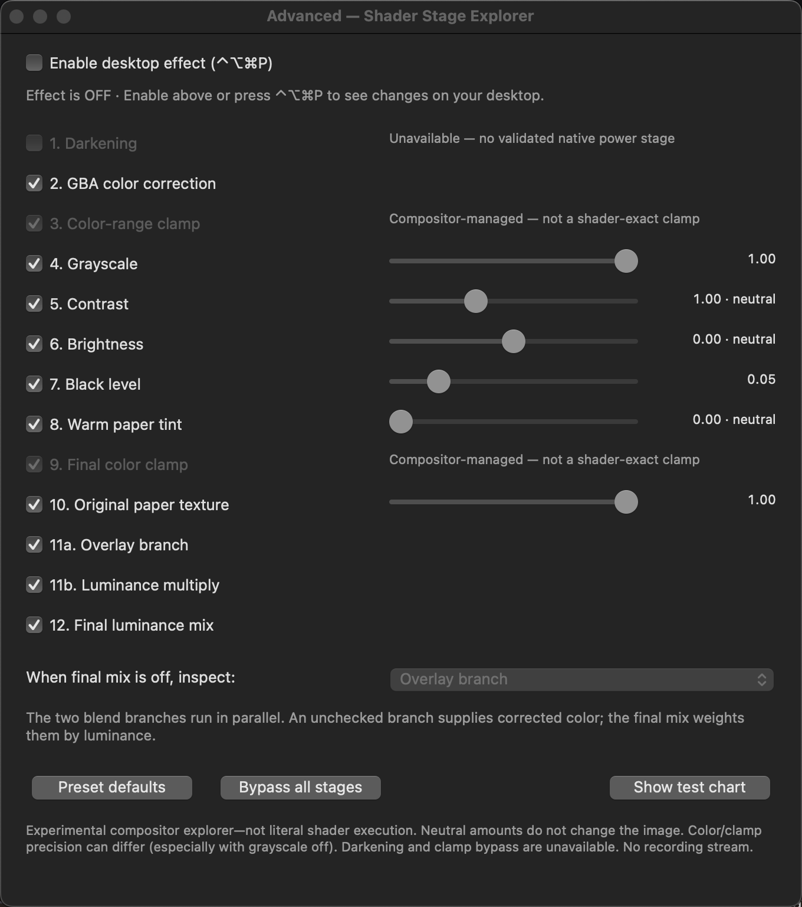

# PaperCompositor

A macOS menu-bar app with three tunable paper/e-ink looks **without a screen-recording stream**: **Original Paper**, **Soft Reading**, and **Surface Dots**. It reconstructs the [eink_slang](https://github.com/crutchcorn/eink_slang) blend and a [Surface Dots-inspired reading effect](https://github.com/snes19xx/surface-dots/blob/main/.config/hypr/shaders/reading_mode.glsl) using WindowServer compositor layers, rather than executing arbitrary shaders.

Extracted from experiments built alongside [ScreenSlanger](https://github.com/crutchcorn/ScreenSlanger). This is an independent, unofficial project—not a replacement for ScreenSlanger's general-purpose shader renderer.



*Earlier controls layout; version 0.5.0 adds a three-look selector and matching breakdowns.*

## Requirements

- macOS 15 or later; tested on Apple Silicon, macOS 15.4.1. Other versions/hardware are not certified.
- Xcode command-line tools (`xcode-select --install`). No Homebrew or third-party build dependencies.
- A user-supplied **4096×4096 paper PNG** from the original shader. The texture is **not distributed here**; see [attribution and licensing](#attribution-and-licensing).

**Private APIs:** `CABackdropLayer` and `CAFilter` are unsupported Apple interfaces and can break with OS updates. This is experimental software, not an App Store application.

## Build and run

```sh
git clone https://github.com/anishthite/PaperCompositor.git
cd PaperCompositor

# Obtain the original shader/texture separately; keep its folder outside this repo.
git clone https://github.com/crutchcorn/eink_slang.git ../eink_slang
export PAPER_TEXTURE="$(cd ../eink_slang && pwd)/shaders/eink_slang/png/4k/textured_paper.png"

./scripts/build.sh --self-check
./scripts/build.sh --advanced
```

If the texture is already installed with ScreenSlanger, the script also recognizes:

```text
~/Documents/ScreenSlanger/Shaders/eink_slang/shaders/eink_slang/png/4k/textured_paper.png
```

Output: `/tmp/PaperCompositor/PaperCompositor.app`. The script ad-hoc signs the app, includes license notices, and copies your PNG into the local bundle. It does not download assets. To keep your build:

```sh
mkdir -p ~/Applications
ditto /tmp/PaperCompositor/PaperCompositor.app ~/Applications/PaperCompositor.app
open ~/Applications/PaperCompositor.app
```

Quit the destination app before replacing it. `PAPER_COMPOSITOR_BUILD_DIR` overrides the build directory; the build script refuses to overwrite an executable that is in use.

The app **starts disabled**, unless launched with `--enable`. It does not require screen-recording or Accessibility permission. Disable any existing ScreenSlanger effect before enabling this one, to avoid stacking effects.

## Controls

- **⌃⌥⌘P** toggles the desktop effect globally.
- **Paper → Controls…** offers master enable, the **Look** selector, and that look's strength.
- **Paper → Breakdown & Tune…** opens the selected look's stage controls.
- Selecting a look in any panel or the Paper menu opens its matching breakdown and hides the previous one.
- **Quit** removes the overlay; emergency exit: `pkill -x PaperCompositor`.

| Look | Its own breakdown |
|---|---|
| **Original Paper** | GBA correction, grayscale, contrast, brightness, black lift, tint, original PNG and both blend branches |
| **Soft Reading** | BT.601 grayscale, gentle original tone, procedural grain/fibers, Bayer texture, highlight mask, cream/charcoal palette and vignette |
| **Surface Dots** | The same Reading stages, but with a native lookup of the source gamma/S-curve/midtone response at full grayscale |

All three have **independent saved stage toggles, amounts and strength**. Switching or resetting one does not change another. The selected look's title and tone-stage label identify exactly what you are tuning. Defaults and bypass apply only to the active look; bypass retains its amounts.

Soft Reading restores the earlier `clamp(gray × 1.18 − 0.09)` tone. Surface Dots is closer to its source, but **not full-shader equivalent**: texture/mask/vignette and spatial-tint differences remain. Partial/bypassed grayscale intentionally retains the affine color-exploration path; a **Color retained** warning appears whenever grayscale is below 100%.

**Other modes** retains legacy Color Only and Matte Only. The former standalone Advanced mode is now Original Paper's active tuning panel, with its previous settings preserved.

The overlay and luminance-multiply branches are **parallel**, not sequential filters. Turn off **Final luminance mix**, then select a branch to inspect it. A disabled branch substitutes corrected color.

Original Paper's darkening is unavailable. Its two shader clamps cannot be independently reproduced/bypassed; those rows are informational and disabled. The selected look and tuning persist; enabled state does not. The original bundle identifier is retained to preserve existing settings.

On upgrade, the two Reading profiles are seeded once from the former shared Reading settings, then remain separate. Original Paper keeps the existing Advanced settings and receives its own strength. The active Reading profile remains mirrored to the old preference key for rollback compatibility.

Fresh-launch options: `--controls`, `--advanced` (Original Paper breakdown), `--reading` (last selected Reading look), `--enable`, `--chart`, `--color-only`, `--paper-only`. Use `--build-only` or `--self-check` alone.

## How it works

**Original Paper:** one shared, native-scale backdrop group per display supplies corrected desktop color `C`:

```text
O = overlay(C, mix(0.5, paper, strength))
L = mix(C, C × paper, luminance(C) × strength)
output = mix(O, L, luminance(C))
```

The original paper is top-left anchored, sampled at native pixel scale with nearest filtering, and black-bordered outside its 4096-pixel domain—not stretched or repeated. Paper strength changes two blend weights, rather than fading the entire overlay.

Color-slider changes update the existing filters. Branch changes rebuild the graph without implicit animation. Active-Space hosts are recreated after desktop changes to avoid stale white backdrop clones; the incoming desktop may briefly be unfiltered during the transition.

There is no capture/render loop, frame timer, network access, sudo/SIP modification, or system gamma/accessibility-setting change in the app. Clicks pass through the overlay; controls remain above it.

**Reading looks:** native grayscale/tone/palette filters share a backdrop group. Source tone uses a cached 1024-sample lookup; Soft reuses the original affine response. Procedural grain/fiber/Bayer tiles are generated once, repeat every 256 native pixels, and use highlight-masked multiply layers. A native radial gradient supplies the approximate vignette. No texture downloads or frame timer are added.

## Fidelity, checks, and limits

```sh
python3 tests/test_build.py
python3 tests/test_blend_graph.py
./scripts/build.sh --self-check
```

These runnable checks verify blend algebra, color-stage math, graph topology, masks, texture geometry, source/Soft tone behavior, one-time profile migration and independent tuning at 1×/2×. **They do not prove rendered equality or power savings.**

The optional [Reading color audit](READING_VALIDATION.md) includes a standalone bounded screenshot probe and independent, profile-calibrated reference. It requires separately authorized screenshot access and an unlocked desktop; the app itself still needs no screen-recording permission. It measured:

| Reading color stages | Maximum native RGB8 error, out of 255 |
|---|---:|
| Grayscale / palette | 0.666 / 0.682 |
| Surface Dots tone / tone plus palette | 2.282 / 2.308 |
| Soft versus its own affine formula | 0.750 |
| Soft versus the earlier rendered tone | 0 in the tested scenes |

These numbers exclude grain, mask, vignette and spatial tint; **2.308 is not a full-effect error bound**.

Prior experiments on the tested Mac measured:

| Check | Observed result |
|---|---|
| Original texture, all 16,777,216 texels | Exact captured device-RGB8 match in the final native test |
| Preset effect over the complete RGB8 input cube | Up to 2 encoded RGB8 units of error |
| Focused Advanced grayscale-off case | Up to 9 encoded RGB8 units of error |
| Advanced mixed color settings | Up to 7 encoded RGB8 units of error |
| All-stage bypass / texture-only bypass | Exact in the checked scene |

These are finite measurements from the original ScreenSlanger experiment workspace, not a guarantee for every parameter, display, or OS. Its original-preset production-renderer harness and raw captures are **not included in this standalone extraction**. The new standalone Reading audit is included separately; it does not reproduce that historical original-preset audit.

**The complete effect is not shader-exact.** Native color/clamp precision can differ, especially with grayscale off. Matte Only intentionally differs from the original preset. Arbitrary shaders, HDR, universal color/profile equivalence, all parameter cross-products, cancelled trackpad Space swipes, and energy/latency improvements are not established. Measure total WindowServer/GPU cost before claiming efficiency gains.

## Attribution and licensing

The e-ink shader, paper texture, and compositor technique predate this project. The contribution here is their native compositor reconstruction, layered controls, active-Space hosting, and validation work.

| Source | Credit / relationship |
|---|---|
| [ScreenSlanger](https://github.com/crutchcorn/ScreenSlanger/tree/5dd25807a86b4aaa0f7c401a18bee370a38287c4) | Original development context and shader-rendering reference; upstream by [crutchcorn](https://github.com/crutchcorn), building on [Brandon Pickering's ScreenShader](https://github.com/branpk/ScreenShader/) and [ShaderGlass](https://github.com/mausimus/ShaderGlass). Its MIT notice is retained. |
| [eink_slang](https://github.com/crutchcorn/eink_slang/tree/16e29791f9a72b14723a8596af6d9edd00a9bf6f) | crutchcorn's e-ink preset, blend formula, parameter semantics, and paper asset used as the reference—not original PaperCompositor artwork. |
| [surface-dots reading_mode.glsl](https://github.com/snes19xx/surface-dots/blob/main/.config/hypr/shaders/reading_mode.glsl) | snes19xx's grayscale/tone/cream-charcoal reading look inspires the Reading variants; independently reconstructed with native layers, not a bundled GLSL shader. |
| [Original textured-LCD shader discussion](https://forums.libretro.com/t/simple-textured-shader-for-non-backlit-lcd-systems-gbc-etc/15520) | jdgleaver's shader is credited by eink_slang. Its source header credits hunterk and Pokefan531 for the public-domain GBA color correction. The header also credits Greg Hogan (SoltanGris42) for upstream LCD line weighting; PaperCompositor does not implement that LCD-grid effect. |
| [Deckle](https://github.com/Kelvanic/deckle/tree/481dd8ccbf6266b83ff297edcf0c61b9ef20b6f9) | WindowServer-aware backdrop, color-filter, and overlay implementation references; © 2026 Deckle contributors, MIT. |
| [PaperScreen](https://github.com/coreyloftus/paper-screen/tree/5439733ca66489c39304276c6466f34ce8ce3390) | Overlay/texture research reference; not a bundled dependency, and its procedural texture is not used. |
| [SideEye](https://github.com/ishmael07/SideEye/tree/e82605ded630ae5453cfaa0bd43f86c97efd9cdd) | Backdrop/overlay implementation research reference; © 2026 SideEye contributors, MIT. |
| [core-animation-private](https://github.com/kageroumado/core-animation-private/tree/d9931066092669506e8be77bbc86d5d2fa78df03) | Private backdrop API research reference; © 2026 kageroumado, MIT. |

**Code:** [GPL-2.0-or-later](LICENSE), conservatively following the original shader's license declaration. Copyright © 2026 Anish Thite for new contributions; upstream authors retain their rights. See [THIRD_PARTY_NOTICES.md](THIRD_PARTY_NOTICES.md) and [LICENSES/](LICENSES/) for retained notices and source lineage. Reference projects are credited as references, not claimed as runtime dependencies or endorsements.

**Texture:** eink_slang credits [Subtle Patterns](https://www.toptal.com/designers/subtlepatterns/) for its source patterns. The specific PNG's author and redistribution terms have not been verified. It is **excluded from this repository**, and this project's GPL license does not license that artwork. Building embeds your local PNG; confirm the asset's attribution and redistribution requirements before sharing an app bundle. No prebuilt app containing it is published here.
